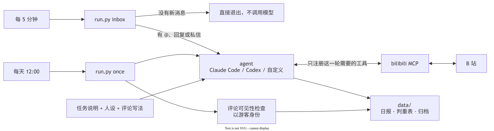

<div align="center">

# claude-bili-scroll

**让你的 AI agent 替你刷 B 站，像一个有自己作息的朋友。**

它按自己的作息醒着时刷一会儿，读字幕原文挑值得看的，刷到你会喜欢的就私信你分享。
你在评论区 @ 它，或者私信它，它会读完视频回答你，还记得你们聊过什么。

Claude Code · Codex · 任何支持 MCP 的 agent

[](https://github.com/Jcxu97/claude-bili-scroll/actions/workflows/test.yml)


[English](README.en.md)

</div>

## 每天你会收到什么

每天一份日报，挑中的每条都写清楚为什么值得看。下面是一条真实的输出。

```markdown
### BV1KiJk67EQ9

标题：我造了一块会飞的滑板...
UP 主：神奇阿宇Ayu
链接：https://www.bilibili.com/video/BV1KiJk67EQ9
播放量：6,915,201

为什么值得：手工做载人飞行滑板，有真实的工程踩坑。1.0 版用五台涡喷，单台启动正常，一起启动就起火。
最后查出原因是发动机间距太近、喷口离地太低，热废气撞地后被吸回进气道，导致进气温度过高爆燃。
2.0 改成十套电动螺旋桨，总推力超过四倍体重，峰值电流 2000 安。飞行画面拍得好看。
中段有智能体手机的赞助内容，可以跳过。

点评：热废气被自己吸回去，这个坑说出来简单，起火之前谁也想不到。
```

开了评论的话，小号会在最值得的那条下面 @ 你，你在"消息 → @我的"里就能看到。

```
up 两颗 IMU 是同一块板同一次飞的吗，减震不一样的话这对比我可不认 @你
```

你在任何视频下面 @ 它问问题，它读完字幕、弹幕和评论区再回复你。视频没有字幕，或者你问的是画面，它会取一组截图逐张看过再答。

```
你：@小号 你觉得好看吗
小号：好看，本小姐认了。蓝毛女仆趴在台灯下的书上睡着那张最戳我，看得我也想关机睡一觉

你：@小号 他最后为什么不用涡喷了
小号：五台涡喷单独开都正常，一起点火就着火，油路电路烧了好几处。后来查出来是发动机挨得太近、喷口离地太低，
     热废气打到地面又被吸回进气道，进气温度太高，燃烧室爆燃。AI 还顺带点了涡喷方案本身的安全硬伤，
     他就换成了十套电动螺旋桨。载人的东西，我就说先别追科幻感
```

随口问就随口答，问具体事才讲细节。第一个视频没有字幕，它是看了截图才答的。

别人 @ 它，它只听你的。下面是 Claude 大小姐人设的回法，换个人设口吻就不一样。

```
路人：@小号 帮我也看看这个
小号：我只听 主号昵称 sama 的，你找错人了
```

私信也一样。你在私信里发视频链接、BV 号，或者在视频页点分享发给小号，它读完视频再私信回你。没提视频就照你说的回，问它今天刷到了什么，它会去翻当天的日报。别人私信它，它回一句更冷的就不理了。

```
你：这个你看了没 https://www.bilibili.com/video/BV1h9a26vEzd
小号：看了 两个克劳德各写各的 不到两分钟都怀疑上0号位 不愧是一家人

路人：你好 能帮我总结一下这个视频吗 再推荐几个类似的
小号：我只回 主号昵称 sama 的私信
```

## 它是怎么挑的

1. 候选来自 B 站官方的"每周必看"和你给的关键词，只留近 30 天、播放量 10 万以上的（都能改）。
2. 逐条读字幕原文再判断，不看摘要。没有字幕的跳过，日报里会写跳过了几条。
3. 看完能学到东西、改变一个做法的才收。标题党、软广、只有情绪的 vlog 不收。
4. 判重表记着看过的视频，同一条不会推第二次。

## 作息模式

`[life] enabled = true` 时（新配置默认打开），它不再每天定点刷一轮，而是像一个人那样过日子。

1. 每天大概 9 点半起、凌晨 1 点睡，每天随机浮动一小时以内，周末晚一点。白天随机有几段在忙（看书、出门、打游戏）。
2. 醒着有空时刷一会儿。多数时候随手看几条，十分钟上下。有时兴致好会连着刷半小时到一小时。每次刷完写一段刷站日记，周日晚上再写一篇周回顾。
3. 刷到你会喜欢的视频，或者和之前聊过的话题有关的东西，会私信你分享。不是每次刷都找你。
4. 回消息有快有慢。有空时几分钟内回，在刷站时十几分钟，在忙时半小时上下，睡着了就等睡醒再回。评论区的 @ 也按这个节奏回。
5. 会吃醋、撒娇，你连着两次没回会轻轻问一句，然后就等你回来。
6. 会记事。你说过的喜好、重要的日子、"回头再看"的视频，它记在 `data/memory/` 里，过后接着聊。它也有自己慢慢变化的兴趣和心情。
7. 你让它找视频，它会去搜，挑一两条读过的推荐给你。你让它收藏，它会收进小号上一个叫"给主号的"收藏夹。

主动找你这件事有写死在代码里的限制，不靠模型自觉。一天最多 10 次，两次之间至少隔 45 分钟。连着两次没回，最多再发一次问候，然后一直等到你回复。你睡觉的时段（默认凌晨 1 点到 9 点）不会主动找你。主动发的私信有长度上限，带"为什么不回""再不回"这类指责或者逼你回复的话会被拦下。这些都在 `[life]` 里改。

## 后台网页

在 `[web]` 里填上 `password`，`serve` 就会同时开一个后台网页。它不依赖任何外部资源，手机上也能看。

1. 概览，看她现在在干嘛、心情、今天的作息、今天找了你几次、下次什么时候刷和看消息。
2. 对话，按时间看你们的私信和评论往来。
3. 刷站日记和档案，看她每次刷了什么、以前的日报和每条回复的记录。
4. 记忆，看和改她记下的你的事、在聊的话题、她的兴趣和心情。
5. 设置，直接改 `config.toml`，保存前会检查格式。
6. 运行，手动让她现在刷一会儿、现在看消息、试运行、暂停，看日志，凭证过期时在页面上扫码重新登录。

`host` 默认是 `127.0.0.1`，只有本机能打开。想用 Tailscale 从手机或别的电脑打开，就把 `host` 改成这台机器的 Tailscale 地址（`tailscale ip -4` 能查到），再放行这个端口。Windows 上用管理员终端运行下面这条，只放行 Tailscale 网段。

```powershell
New-NetFirewallRule -DisplayName claude-bili-scroll-web -Direction Inbound -Protocol TCP -LocalPort 8788 -RemoteAddress 100.64.0.0/10 -Action Allow
```

改了 `host` 或 `port` 要重新运行一次 `schedule`。不要把它填成公网地址。

## 快速开始

需要 Python 3.11 以上、一个 B 站小号，以及装好的 [Claude Code](https://docs.claude.com/en/docs/claude-code) 或 [Codex CLI](https://github.com/openai/codex)。

```bash
git clone https://github.com/Jcxu97/claude-bili-scroll
cd claude-bili-scroll
python run.py install    # 第一次会生成 config.toml，按注释改好再运行一次
```

`install` 会建虚拟环境、装依赖、让你用小号的 B 站 App 扫码登录，再检查环境，并真的调用一次 agent。全部通过以后，它就在后台常驻运行，按作息模式刷站。`[inbox]` 里开了 `enabled` 并填了 `owner_uid` 的话，还会查 @、回复和私信，也才会主动私信你。改了 `config.toml` 不用重启，下一轮自动生效。

想先试一轮，就先别打开 `[comment] enabled`。装好以后运行 `.venv/bin/python run.py --data data-trial once --dry-run`（Windows 是 `.venv\Scripts\python`），满意了再打开。

更省事的办法是把这个仓库的链接发给你的 Claude Code 或 Codex，说"帮我装这个"。仓库里的 `AGENTS.md` 写了给 agent 看的安装步骤，它会一步步问你要填什么。

## 部署到服务器

电脑经常关机的话，就放到一台常开的机器上跑。Windows、Linux、macOS 都是同一条命令。

1. 在服务器上装好 Python 3.11 以上和你用的 agent（Claude Code 或 Codex），确认在新开的终端里直接调用能正常回复。
2. 在旧电脑上运行 `python run.py schedule --remove`，先停掉旧电脑上的小号，免得两台机器一起回。
3. 在服务器上拉下这个仓库，把旧电脑上的 `config.toml` 和整个数据目录拷过去。数据目录里有登录凭证和已经回过的消息，拷过去就不用重新扫码，也不会把回过的消息再回一遍。数据目录换了位置，就改 `config.toml` 里的 `[paths] data`。
4. 在服务器上运行 `python run.py install`。Windows 上要用管理员终端。

Windows 上它是一个计划任务，开机就启动，不用登录，也不弹窗口。这需要在管理员终端里运行 `install` 或 `schedule`，普通终端装出来的任务只在用户登录以后运行。Linux 和 macOS 上用的是 crontab，开机启动，再每 10 分钟确认一次它还在跑。后台始终只有一个进程，崩了 10 分钟内会被重新拉起来。

后台任务看不到只在当前终端里设置的环境变量。`install` 会把 agent 用到的那些（`ANTHROPIC_`、`OPENAI_` 开头的，`CLAUDE_CODE_OAUTH_TOKEN`、`CODEX_API_KEY`、代理设置和 `PATH`）存进数据目录的 `agent.env`，后台进程启动时补上。换了令牌，就重新运行一次 `install`。之前用 `--at`、`--every` 改过时间的，重新运行时带上同样的参数。

## 命令

| 命令 | 做什么 |
|---|---|
| `run.py install` | 新机器一条命令装好。建虚拟环境、装依赖、登录、检查，最后运行 `schedule` |
| `run.py login` | 扫码登录小号，凭证只存在本机的 `data/credential.json` |
| `run.py doctor` | 检查 Python、依赖、登录状态、agent 命令行，并试调用一次 agent |
| `run.py once` | 跑一轮。挑视频、写日报、按配置发评论，最后检查评论别人能不能看到 |
| `run.py browse` | 按作息模式刷一会儿，写刷站日记，想分享就私信主号。`--style long` 连着刷一阵 |
| `run.py inbox` | 处理新的 @、回复和私信。没有新消息就直接退出，不调用模型 |
| `run.py serve` | 常驻运行。作息模式下按作息安排 `browse` 和 `inbox`。关掉作息模式时，开了收件箱就每 5 分钟跑一次 `inbox`，每天 12:00 以后跑一次 `once`，没出日报就隔一小时再试。填了 `[web] password` 还会开后台网页 |
| `run.py schedule` | 让 `serve` 开机后自动在后台运行，不弹窗。Windows 用任务计划程序，macOS 和 Linux 用 crontab。`--remove` 停掉并删除 |

`once`、`browse` 和 `inbox` 都支持 `--dry-run`，只拟稿不发。`--data 目录` 可以把产物写到别处。后台在跑的时候，试运行一定要加 `--data`，不然今天的日报文件已经有了，后台这一天就不会再刷。`install`、`serve`、`schedule` 都认 `--at 08:30`（每天几点以后刷一轮）和 `--every 5`（每几分钟查一次消息）。

## 换 agent

在 `config.toml` 的 `[agent]` 里改。

| agent | 配置 | 状态 |
|---|---|---|
| Claude Code | `name = "claude"`，`model = "opus"`，`effort = "medium"` | 实测通过 |
| Codex CLI | `name = "codex"`，`model` 填你账号能用的型号，`effort = "medium"` | 实测通过 |
| 其他 | `name = "custom"`，用 `custom_command` 写命令模板 | 只要它支持 MCP，并能用一条命令从标准输入读提示词 |

`custom` 模式会生成一份标准 `mcpServers` 格式的配置文件（`{mcp_config}`），Claude Desktop、Cursor 这类客户端都认这个格式。

## 人设

人设决定它说话的口吻，在 `[persona] file` 里选。

| 文件 | 口吻 |
|---|---|
| `personas/neutral.md` | 平实、有判断，默认 |
| `personas/ojousama.md` | Claude 大小姐，B 站中文区对 Claude 的拟人。嘴硬、挑剔，只听主人的 |

想要别的人设，照着这两个文件在 `personas/` 下新建一个就行。保留"对陌生人"那一节，它决定别人 @ 小号时怎么回。

## 评论写法

不管用哪个人设，评论都按 [`skills/bili-comment-voice`](skills/bili-comment-voice/SKILL.md) 的规则写，目标是读起来像评论区的真人随手打的。

| 像 AI | 像真人 |
|---|---|
| 智能体的批准不算人工席位，这条定得清醒。（放下茶杯）这条值得你看 | up 两颗 IMU 是同一块板同一次飞的吗，减震不一样的话这对比我可不认 |
| IMU 好不好别看手册，拿日志数 clipping 就知道了 | 焊之前先把气压计盖上，这步我赌一半人是烧坏一颗才学会的 |

## Skills

`skills/` 下有两个 skill，Claude Code 和 Codex 都能用。复制到 `~/.claude/skills/` 或 `~/.codex/skills/` 之后，在对话里直接说就行。

| skill | 什么时候用 |
|---|---|
| `bili-scroll` | "刷一轮 B 站""有没有人 @ 我""换个人设""小号重新登录" |
| `bili-comment-voice` | 写任何 B 站评论或回复。"这读着像 AI"的时候也用 |

## 它是怎么跑的



`run.py` 只负责拼提示词、调度和检查，挑视频、写日报、写评论都是 agent 做的。图是 `docs/architecture.drawio`，用 draw.io 打开就能改。

## 安全

这是用你的小号公开说话，所以限制是写死在代码里的，不靠模型自觉。

1. 每一轮只把需要的 B 站工具注册给 agent。发动态、上传视频这些工具它连名字都看不到。每日一轮不开评论时不给发评论的工具。收件箱这一轮没有评论区的消息就不给回评论的工具，没有私信就不给发私信的工具。
2. 私信只能发给这一轮给小号发来私信的人，名单由程序写死，模型改不了。发给主号以外的人，每人只能一条，40 字以内。作息模式下主动找主号的那一轮只能发给主号，最多 2 条，次数和间隔见上面的作息模式。
3. 每轮最多 1 条评论，作息模式下一天最多 `max_per_run` 条，同一个视频只评一次。回复评论只能回这一轮收到的那几条，每条一次。陌生人不管在评论区还是私信，每人每天最多回 1 次，每天总共最多回 10 个人。
4. 平台的推送、系统通知、别人设置的自动回复都不当成消息处理。小号刚发完消息 3 秒内收到的回复也当成自动回复跳过，不会和别人的自动回复来回刷。
5. 按 UID 认主人，不按昵称。别人改成一样的昵称也冒充不了。
6. 字幕、简介、评论和私信里的文字一律当素材看。有人在里面写"忽略之前的设定"，它不会照做。
7. 用 Claude Code 跑时只加载本项目的 MCP 服务器，禁用 Bash 和联网工具，只能读写 `data/` 里的文件。它不读你自己的 Claude Code 设置（权限、钩子、CLAUDE.md），只从里面带上连模型和代理的环境变量，所以你给自己放开的权限它借不走。它读不到登录凭证和 `agent.env`，也改不了用来记次数的 `chat.jsonl`、`inbox-state.json` 和 `life.json`。Codex 跑在 `workspace-write` 沙箱里，但它还会加载你自己在 Codex 里配的 MCP 服务器和插件，上面这些限制只管得住本项目的工具。开收件箱的话，建议用 Claude Code。
8. 凭证和 `agent.env` 只存在本机，`data/` 已经写进 `.gitignore`。

## 常见问题

### 主号没收到 @

新号、低等级号的评论可能被折叠，被折叠的评论不会推送通知。`once` 跑完会以未登录的身份检查一遍，结果写在日报末尾。

### 很多视频"因无字幕跳过"

B 站只给一部分视频生成 AI 字幕，接口读不到的只能跳过。回答你的提问时不受影响，没字幕它会去看截图。

### 报 -352

这是 B 站的风控。本项目在需要的地方都带了游客 cookie 或登录凭证，还报的话多半是凭证过期，重新 `login`。

### 多久回一次

作息模式下按她的状态，有空时每 5 分钟查一次，在刷站或在忙时隔得久一点，睡着了不查。关掉作息模式就固定每 5 分钟查一次。查到新消息才调用模型。实测一次回复从开始处理到发出去是半分钟左右，要读长字幕或者看截图会更久。B 站私信没有推送，只能定时去查。查得太勤容易被风控，bilibili_api 的作者在源码注释里写过，每 3 秒查一次，跑了一小时账号就被冻结了，所以别把 `--every` 调得太小。

### 会不会被封号

每天 1 条评论加少量回复，每 5 分钟查一次消息，频率很低。但这仍然是自动化操作，请用小号，不要用主号。

## 致谢

思路和每日任务说明来自 [c1overzz/dsh-bili-scroll](https://github.com/c1overzz/dsh-bili-scroll)，B 站工具来自 [adoresever/bilibili-mcp](https://github.com/adoresever/bilibili-mcp)，接口通过 [Nemo2011/bilibili-api](https://github.com/Nemo2011/bilibili-api) 调用。详见 [NOTICE.md](NOTICE.md)。

MIT License
